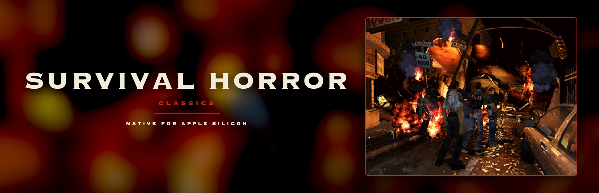
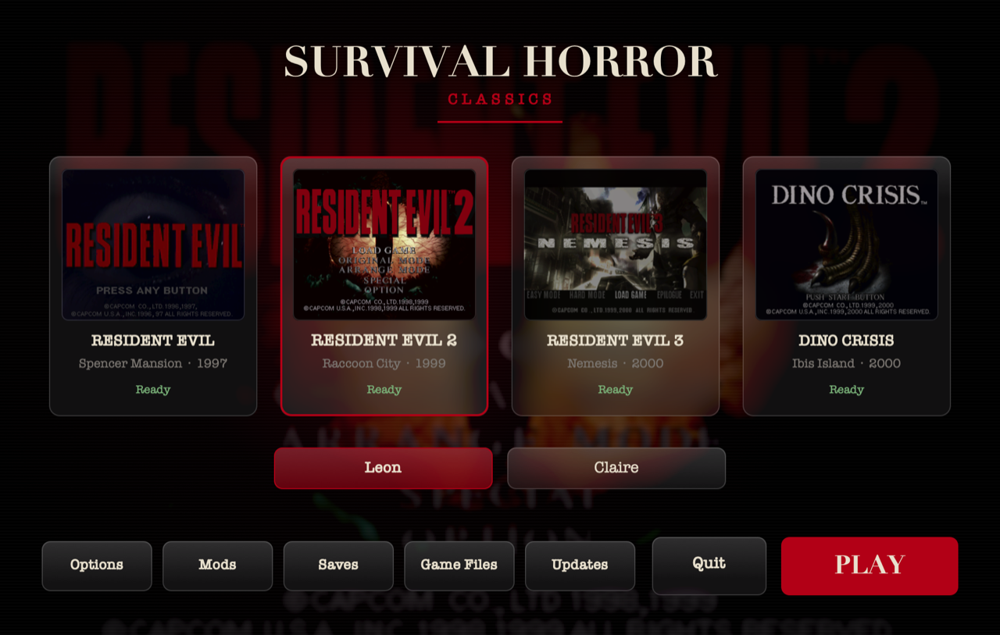
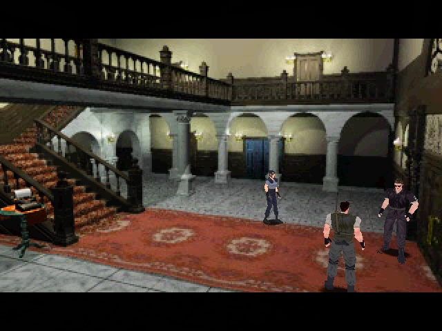
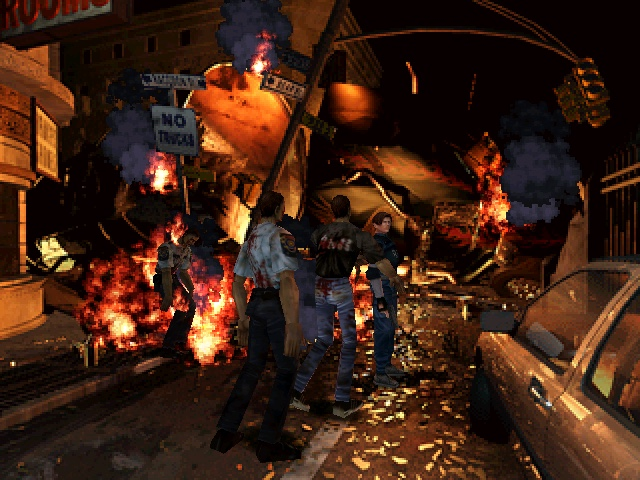
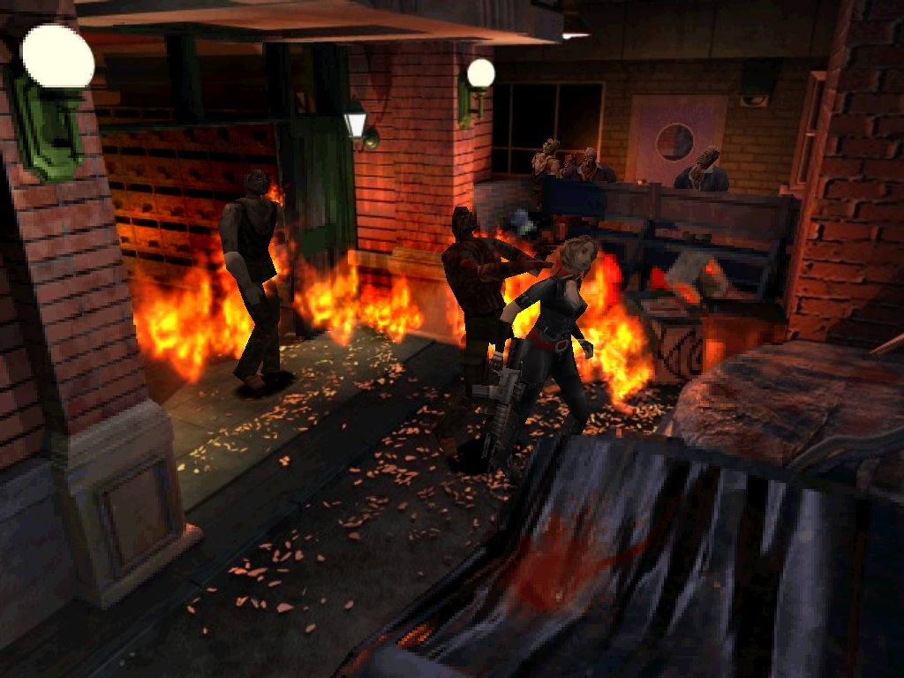
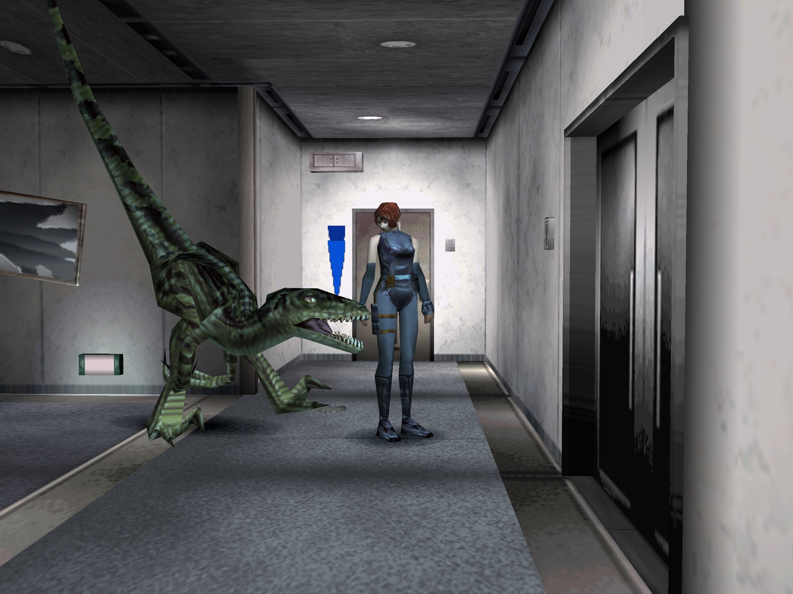
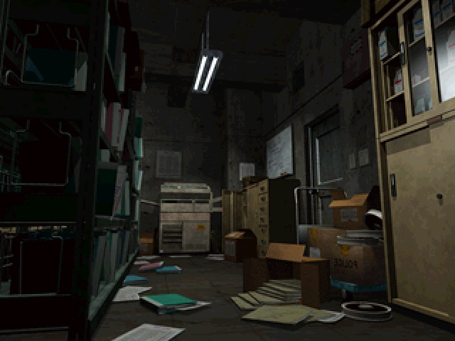

# Survival Horror Classics: Resident Evil 1-3 and Dino Crisis, native for Apple Silicon



Capcom's **Resident Evil** (1997 PC), **Resident Evil 2** (1999 PC), **Resident Evil 3: Nemesis** (2000 PC) and
**Dino Crisis** (2000 PC), statically recompiled from **your own GOG copies** into native arm64 code and drawn with
Metal: no Wine, no Rosetta, no emulator. One app, **Survival Horror Classics**, with a card for each game. It uses the
recompiler and Windows runtime of the author's GTA Classics and Dungeon Siege ports.

No game files are in this repository. The installer reads the games you bought: the GOG releases, whose programs carry
no copy protection (the Steam releases are wrapped in Enigma and are not used).

## Screenshots

| | |
|---|---|
|  |  |
|  |  |
|  |  |

## Status

| Game | Program | State |
|---|---|---|
| Resident Evil | `ResidentEvil.exe` | Plays: title, intro, the mansion; Direct3D 1 execute buffers, its own task system |
| Resident Evil 2 | `LeonU.exe`, `ClaireU.exe` | Plays: movies, menus, the city and the police station with their backgrounds, 3D at 30 fps |
| Resident Evil 3: Nemesis | `ResidentEvil3.exe`, `RE3_MERCE.exe` | Plays: movies, menus, the city, 3D |
| Dino Crisis | `DINO.exe` | Plays: title, briefing, movies, the facility; its text and sprites keyed as on Windows |

## Install

```sh
brew install innoextract ffmpeg          # unpacking the GOG installers; converting two games' movies
./install.sh --branch nightly            # every game found; or --games re1,re2,re3,dc
```

The games are read where they are: `<games root>/<Game>Native/game-files/<title>`, by default on the
*Expansion Pak* SD card (`/Volumes/Expansion Pak/Games`; `--games-root DIR` for another place). A game that is not
there yet is unpacked from its GOG installer (`setup_*.exe` and its `.bin` parts in `--installers DIR`, by default
`/Volumes/Expansion Pak/GOG Installers`). Saves and settings stay on the Mac in `~/Games/SurvivalHorrorClassics`.
When the card is out, the launch window says to insert it.

Resident Evil's Cinepak movies and Resident Evil 2's Indeo 5 movies get MPEG-1 copies beside them (`<file>.mpg`,
`recomp/tools/convert_movies.sh`, ffmpeg while it runs); Resident Evil 3 and Dino Crisis are MPEG-1 already. The
originals are not changed.

## The launch window

A card per game showing its own title screen, over that title screen blurred behind frosted glass (captured from your
copy at install; GOG's store banner from the game folder until then). Under the cards: Resident Evil 2's **Leon /
Claire** and Resident Evil 3's **game / The Mercenaries**. Then:

- **Options**: Display (full screen with Game Mode, or a window), Around the Notch (below it, or around it), VSync,
  Texture Filtering, Movies, Test Aids.
- **Mods**: the chosen game's mods (see [Mods](#mods)); the tile says how many are on.
- **Saves**, **Game Files**, **Updates** (rebuilds the app from the branch it follows), **Quit**, **Play**.

A controller works in the launch window: d-pad or left stick to choose a game (up/down: the version), A or Start to
play, Y for Options (up/down a row, left/right/A to change it), X for Mods, B to quit or close Options. The keyboard
does the same with the arrows, Return, Space, M and Escape.

## Mods

The **Mods** tile opens the chosen game's mods (Resident Evil 2's Leon and Claire share one list; so do Resident Evil 3
and The Mercenaries):

- **Browse GameBanana…** (Resident Evil 1-3): search, or the most downloaded, newest or most liked mods for the game,
  with their pictures; **Install** downloads one and installs it. Dino Crisis has no GameBanana section.
- **From File…**, or drop a zip, rar or 7z (or a single file) on the window.
- Each mod's checkbox turns it on or off; **Up** / **Down** set the order (the first wins where two change the same
  file); **Remove** sends it to the Trash; **Show Folder** opens it in Finder.

**The game folders are never changed**, so there is nothing to back up. Mods live in
`~/Games/SurvivalHorrorClassics/mods/<re1|re2|re3|dc>/`, and the game reads an enabled mod's copy of a file in place
of its own. Switching a mod off or removing it brings the original back. Resident Evil 3's files sit packed inside its
`Rofs*.dat` archives; its mods are read through the archive reader itself, so those archives stay untouched too.

Mods for these games come in every shape, and installing places each file by the game's own layout:

- A tree like the game's (`Pl0/PLD/PL00.PLD`) goes in as it is.
- A Classic REbirth-style folder relative to Resident Evil's `USA` folder (`ENEMY/EM1003.EMD`) goes under `USA`.
- Bare files (`PL00.PLD`) are matched by name to the game's own (Resident Evil 3: to the files in its archives).
- Resident Evil 2 asks whether a model is for Leon's game (`Pl0`), Claire's (`Pl1`) or both.
- Readmes and pictures are kept in the mod's `_extras` folder.

What can't run is kept but stays off, with the reason shown:

- **DLL-based mods** (Classic REbirth itself, texture-pack loaders): Windows code; the port has its own renderer.
- **Classic REbirth texture packs** (folders of PNGs): the port has no texture replacement.

### Restore from Disc

**Restore from Disc…** turns your own PlayStation discs into mods for the chosen game. Point it at a folder of disc
images (BIN/CUE or CHD; a plain `.iso` drops the voices and movies) or at one image. Each disc is known by its serial
(Resident Evil: original, Director's Cut, Dual Shock; Resident Evil 2: both discs, original or Dual Shock; Resident
Evil 3; Dino Crisis).

- **PlayStation voices** (all four games): the disc's voice lines in place of the PC's.
  - Resident Evil 1-3: 37.8 kHz with the full top end, where the PC's are 22 kHz or re-compressed.
  - Dino Crisis: without the PC's 8-bit hiss.
  - Every line is matched to the PC line it replaces by its waveform, then cut to that line's timing and set to its
    loudness, so scenes and the mix stay as they were. Lines the disc doesn't have stay the PC's.
- **PlayStation music** (Resident Evil 2, Dino Crisis): rendered from the disc's own sequences and sample banks, as the
  PlayStation's sound chip plays them (its sample decoding, interpolation, envelopes and reverb), at 44.1 kHz stereo.
  Resident Evil 2's PC plays 22 kHz ADPCM recordings of the same music; Dino Crisis's, 8-bit ones. Each render is
  matched to the PC track it replaces and cut to its start and length; loops are cut from the render's own loop, so
  they are seamless, and loop where the PC's do.
- **PlayStation sound effects** (Dino Crisis, Resident Evil): the PC's effects are the disc's samples converted
  (Dino Crisis to 8 bits; some of Resident Evil's down to 22 kHz). Each is matched to its disc sample on the waveform
  and replaced by it at 16-bit 44.1 kHz, at the PC effect's pitch, timing and loudness. Resident Evil only takes the
  ones the PC cut down.
- **PlayStation movies** (all four games, each its own switch in the list):
  - Resident Evil (on): 15 fps where the PC's are 10 fps Cinepak, and the uncut colour cuts where a disc has them (a
    Director's Cut Dual Shock with the original content restored). The PC's staff rolls stay, because their credits are
    part of the picture.
  - Resident Evil 2, Resident Evil 3 and Dino Crisis (off): the disc's own movies, for the PlayStation look. The PC's
    are as good or better (Resident Evil 2 at 30 fps, Dino Crisis at 640×480, Resident Evil 3 the same frames), so
    they stay unless you switch these on.

What stays the PC's, and why: Resident Evil's music (the PC's isn't a rendering of the disc's sequences, so there is
nothing to match it to), Resident Evil 3's music and effects (the same files as the disc's), and Resident Evil 2's
effects (the same 4-bit samples as the disc's). Each mod's line in the list says how many files it replaces.

Resident Evil 3's PC voices are packed in its archives, so restoring them runs the game for a few seconds in the
background to unpack them with its own reader. The mods appear at the top of the list, switched on (the optional
movies off); restoring again replaces them. A restore takes a few minutes per game.

From a terminal: `"Survival Horror Classics Nightly.app/Contents/MacOS/SurvivalHorrorClassics" --install-mod re2
<archive> [leon|claire|both]`, and `--list-mods <game>`.

## Controllers

Any controller macOS knows (Xbox, PlayStation, Switch Pro, MFi) is the games' joystick: DirectInput's gamepad for
Resident Evil 3 and Dino Crisis, winmm's joystick for Resident Evil and Resident Evil 2. It is always there for the
games, idle until a controller connects, so one turned on after the game started still works. The d-pad also drives
the left stick (the games read the stick to walk and in menus). Buttons are mapped in each game's own controller
settings, as on Windows.

**To quit a game with the controller, hold Back and Start together for two seconds** (View and Menu on Xbox, Create and
Options on PlayStation, - and + on Switch): a prompt shows while you hold, letting go cancels, and you land back in the
launch window. On the keyboard, Cmd+Q quits.

## Frame rate

The four games run their world in fixed 30-frame steps (menus at 60); a higher rate would only make them run faster, so
the frame rate stays the games' own. VSync paces the frames to the display (ProMotion included), with Game Mode in full
screen.

## Test Aids

Options > Test Aids (or `SHC_AIDS=1`): the player's health is held full (Resident Evil, Resident Evil 2, Resident Evil
3, The Mercenaries, Dino Crisis), and Resident Evil 2 gets GOG's own all-weapons switch (`-wepall`; the inventory was not checked). For testing a room:
`SHC_ROOM=<stage><room>` (as the room files are named, `101` = stage 1 room 01) makes the first room a new game loads
that one (Resident Evil, 2 and 3 and Dino Crisis; at the room's first camera, the player where the new game put them), and
`SHC_ROOM_AT=<n>` the n-th. In Dino Crisis that spot is the opening room's, which may be off another room's floor;
`105` and `203` were checked (Regina in the room, walking, and in `203` surviving a raptor's attack with health held).
`recomp/tools/re_qa.sh <folder>` is the QA pass: each
version from the installed app through a new game and a set of rooms, with a contact sheet and a report.

## How it works

See [docs/PORT.md](docs/PORT.md): the recompiler, DirectDraw 1-4 and Direct3D 1-3 on Metal, GOG's patches, the movie
player, Resident Evil's task system, and what each game needed.
