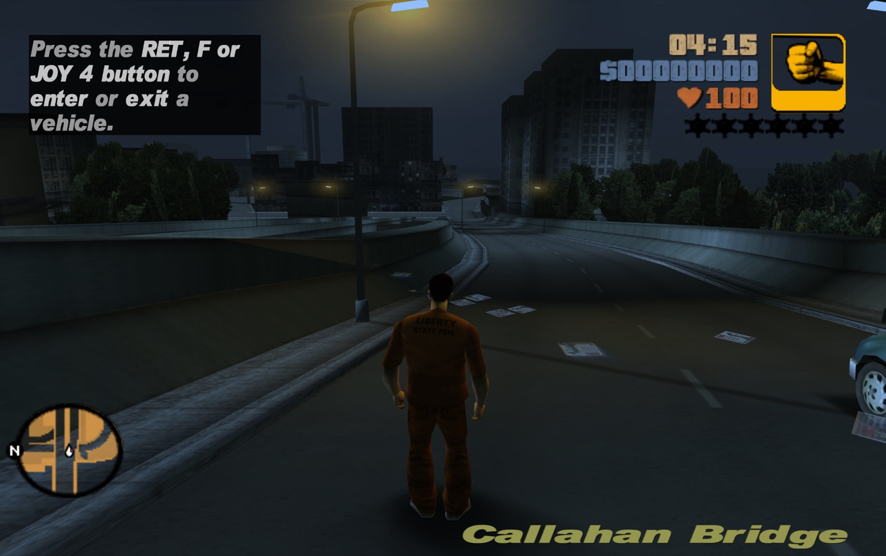
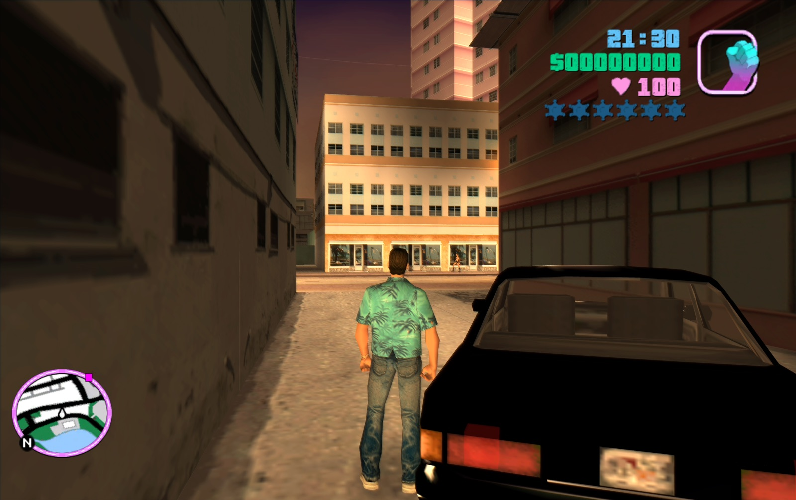
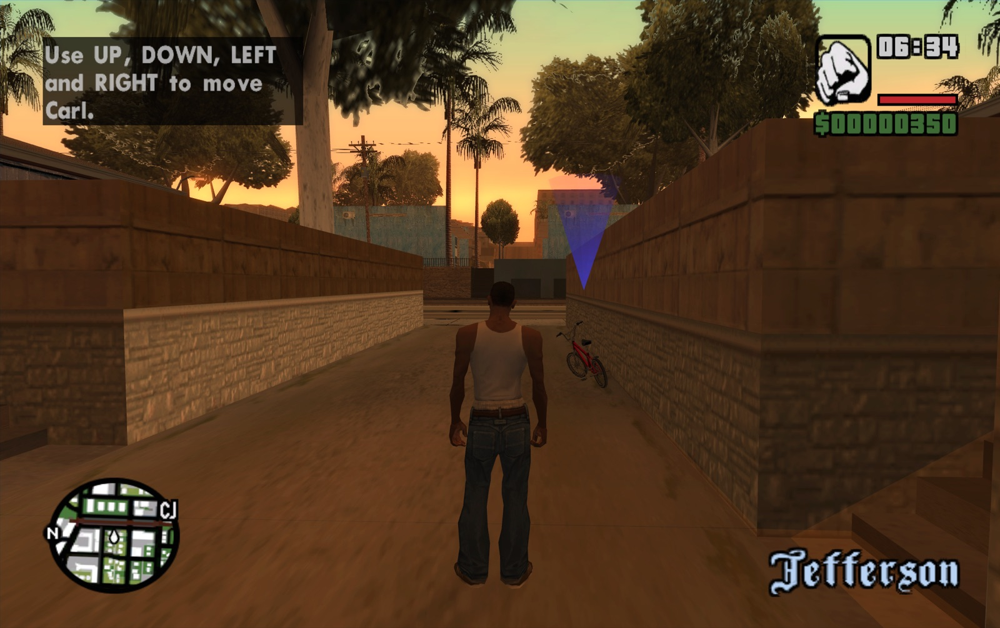
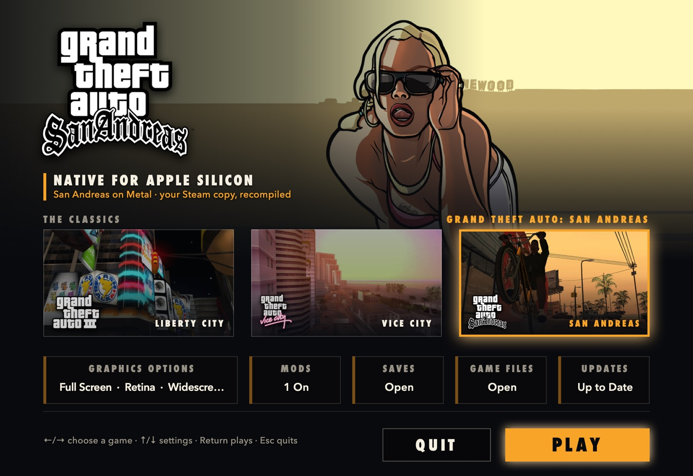
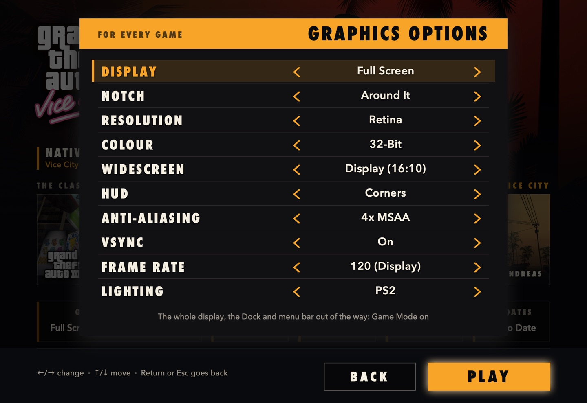

# GTA Classics: GTA III, Vice City and San Andreas, native for Apple Silicon

Rockstar's **Grand Theft Auto III** (2001), **Vice City** (2002) and **San Andreas** (2004), statically recompiled from
your own Steam copies into native arm64 code and drawn with Metal: no Wine, no Rosetta, no emulator. One app,
**GTA Classics**, with a card for each game. It uses the same recompiler and Windows runtime as the author's Dungeon
Siege, Delta Force, Diablo II, Fallout: New Vegas and Sims ports.

| | |
|---|---|
|  |  |
|  |  |

Nothing from the games is in this repository. `./install.sh` imports your copies (an APFS clone: no extra space),
undoes the Steam wrapper on a copy in the build folder, recompiles that copy and installs the app. The Mac releases on
Steam are the Windows games inside TransGaming's Cider wrapper, 32-bit Intel programs that no longer run on current
macOS; this port takes the Windows executables from inside them.

## What you get

- **Widescreen, the right way.** The 3D view widens with the screen and keeps the 4:3 height (Hor+), in the display's
  own shape (a MacBook's 16:10, below or around the notch) or a true 16:9. The HUD keeps its shape in the corners (or
  centred in a 4:3 frame); menus and loading screens are shown 4:3. Each game's own Widescreen switch turns it on and
  off.
- **60 fps or the display's rate.** Timers, flashing, particles, spin damping and scripted gates and lifts are kept at
  the 30 fps pace the games were made for (FusionFix's HighFPS fixes, ported). The games' frame limiters, which
  turned San Andreas' 30 into 25 (and 60 into 43) and GTA III's and Vice City's 120 into 60, keep the rate exactly,
  San Andreas' own 14 ms wait a frame is gone, frames below the display's rate are shown evenly, and a game that can't
  come near the display's rate is held at an even 60.
- **PS2 lighting.** San Andreas' PS2 colour filter (the warm Los Santos look) and its radiosity glow, Vice City's PS2
  trails, and the PS2's light clamping on cars and people in all three. GTA III's own Trails work at any resolution.
- **Every graphics option works**, in the launcher and in each game's Display Setup: resolution (any size up to the
  display's Retina pixels), 16-bit or 32-bit colour, antialiasing (2x or 4x MSAA), draw distance, frame limiter; and
  anisotropic filtering (16x), so roads and walls seen at a slant stay steady instead of shimmering.
- **Modern controllers** out of the box (Xbox, PlayStation, Switch Pro, any MFi pad), laid out as on the PS2
  (Classic) or as the Definitive Edition's Modern scheme (triggers to drive, aim and shoot; A to pedal a bicycle, tap
  for speed).
- **Sound**: radio, effects and cutscenes in all three (Miles for GTA III and Vice City, DirectSound for San Andreas),
  and the intro movies.
- **Mods**: a Mods window that browses GameBanana, installs file mods and orders them. For San Andreas, *Restore
  from Disc* brings back what later releases removed (the cut radio songs, the 2005 signage and loading screens,
  the original scripts) from your own 2005 DVD, with an opt-in Hot Coffee switch.

See [docs/GRAPHICS.md](docs/GRAPHICS.md), [docs/CONTROLLERS.md](docs/CONTROLLERS.md) and [docs/MODS.md](docs/MODS.md)
for the details, and [docs/PORT.md](docs/PORT.md) for how the port works.

## Installing

An Apple Silicon Mac (the app is built on the Mac it runs on; tested on macOS 27 with an M1 Pro), the Xcode command
line tools (`xcode-select --install`) and the games:

| Game | Where it comes from |
|---|---|
| GTA III | the Mac release on Steam (app 12230) |
| Vice City | the **Windows** release on Steam (app 12110): open Steam's console (`steam://open/console`) and run `download_depot 12110 12111`. The Mac release's executable carries SecuROM with online activation, which this project does not touch. |
| San Andreas | the Mac release on Steam (app 12250) |

```sh
./install.sh                          # every game found in Steam's folder (or imported earlier)
./install.sh --games vc               # just Vice City: games already in the app are kept as they are
./install.sh --branch nightly         # "GTA Classics Nightly.app", following the nightly branch
```

| Option | |
|---|---|
| `--games gta3,vc,sa` | which games to build (default: every one found) |
| `--steam-dir DIR` | Steam's `steamapps/common` (default `~/Library/Application Support/Steam/steamapps/common`) |
| `--gta3-dir`, `--vc-dir`, `--sa-dir` | a game's folder (the one holding `gta3.exe`, `gta-vc.exe`, `gta_sa.exe`) |
| `--app-dir DIR` | where the app goes (default `~/Applications`) |
| `--branch main\|nightly` | which branch the app's updater follows |
| `--no-downloads` | no Steam store art: the launch window writes the titles |
| `--in-place` | read the games where they were found instead of importing them |

Each game builds for several minutes. The imported games live in `~/Games/<GTA3|GTAVC|GTASA>Native/game-files`
(the Steam copies can go afterwards); saves and settings in that folder's `drive_c/Users/player/Documents/<GTA3 |
GTA Vice City | GTA San Andreas> User Files`.

## The launch window



←/→ choose a game, ↑/↓ the tiles, Return plays, Esc quits. The tiles:

- **Graphics Options**, kept for each game (Display and Notch for all): Display (Full Screen / Window), Notch (Below It /
  Around It), Resolution (Standard / Retina / Native, the panel's own pixels when the display is scaled / As Set in
  Game), Colour (32-Bit / 16-Bit), Widescreen (Display shape / 16:9 / Off 4:3), HUD (Corners / Centred 4:3),
  Anti-Aliasing (Off / 2x / 4x MSAA), Texture Filtering (16x / 4x anisotropic / Off as released), VSync, Frame Rate (60 / the display's rate / 30 Original), Lighting (PS2 / PC as
  released), Controls (Classic PS2 / Modern, as the Definitive Edition), Look Speed and Invert Look. The choices are
  given to the game each time it starts; what you change in a game's own Display Setup lasts for that session (choose
  *As Set in Game* to keep the game's resolution).
- **Mods** opens the Mods window. **Saves** and **Game Files** open the chosen game's folders.
- **Updates** rebuilds every installed game from the newest commit of the app's branch; saves and settings are kept.

Play starts the game in the launcher's own process, so macOS keeps Game Mode on. Each game's log is
`~/Games/<X>Native/<GTA3|GTAVC|GTASA>.log`; the launcher's choices are kept in `~/Games/GTAClassics/launcher.plist`.

## State

**Playable, in testing.** All three games run from the main menu through the opening missions with sound, controllers
and the options above; they were checked with the games' own screenshots at 2054×1290 and at Retina 4112×2658.

| Part | State |
|---|---|
| Recompilation | `gta3.exe` 1.1 (20,593 functions, with RenderWare's hand-written `_rwcseg`), Vice City's `gta-vc.exe`, San Andreas' `gta_sa.exe` 3.0 with its C runtime, Ogg Vorbis and EAX DLLs (35,822 functions) |
| Graphics | Direct3D 8 (GTA III, Vice City) and 9 (San Andreas) on Metal; the games' own vertex shaders translated to Metal (MojoShader) |
| Sound | Miles Sound System and DirectSound on Core Audio |
| Input | keyboard, mouse (DirectInput 8) and game controllers |
| Frame rate | at 4112×2658 with 4x antialiasing on an M1 Pro: GTA III 120 fps, Vice City 120, San Andreas 115 (it waited 14 ms a frame of its own: about 71 before); below the display's rate, frames are shown evenly |
| Movies | the intro movies play (macOS's own MPEG-1 decoder); a key, click or pad button skips them |
| Mods | file mods; models and textures meant for the `.img` archives, and ASI/CLEO code mods, are not supported yet |

## Building by hand

```sh
recomp/build_gta3.sh "<GTAIII folder>"                       # -> recomp/work/gta3
recomp/build_gtavc.sh "<Grand Theft Auto Vice City folder>"  # -> recomp/work/gtavc
recomp/build_gtasa.sh "<GTA San Andreas folder>"             # -> recomp/work/gtasa
```

`GTA3_RELINK=1` (GTA III) or `GTA_RELINK=1` (the others) rebuilds only the runtime and links again. See
[recomp/README.md](recomp/README.md) for the recompiler and the test switches.

## Credits

GTA III, Vice City and San Andreas © Rockstar Games / Take-Two Interactive. This project contains no part of them.
The fixes for wide screens and high frame rates follow ThirteenAG's **FusionFix** (MIT), whose patterns found the same
code in these builds; the PS2 colour filter, radiosity and light clamping follow aap's **SkyGfx** descriptions of the
PS2 (reimplemented: SkyGfx has no licence, so no code is taken from it). Full notices: [NOTICE.md](NOTICE.md).
