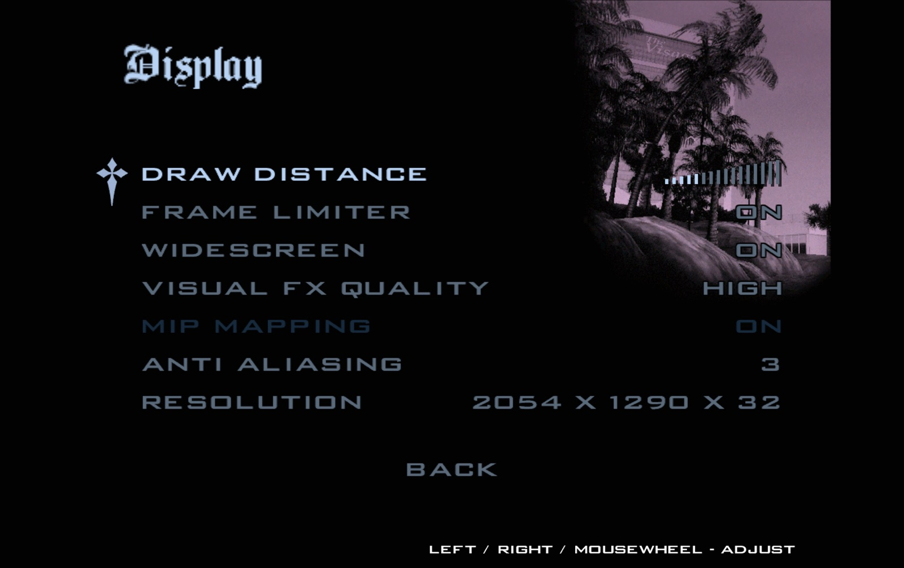
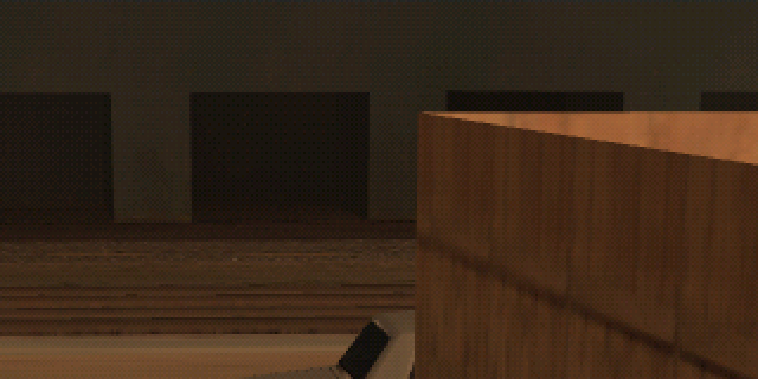
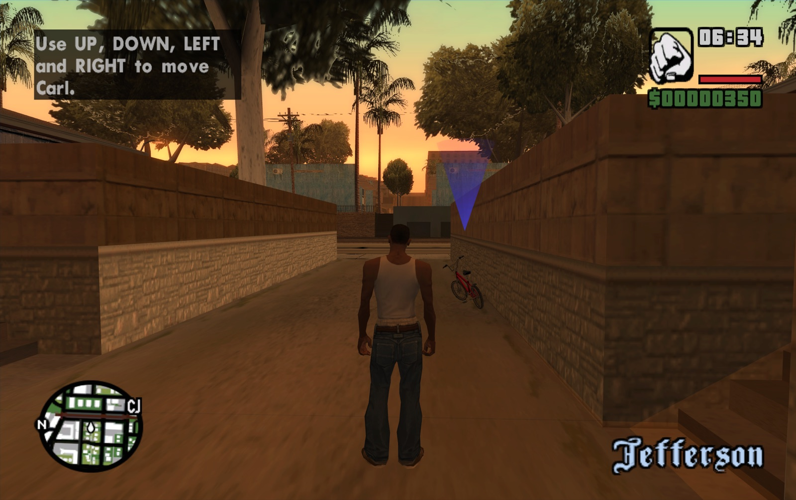
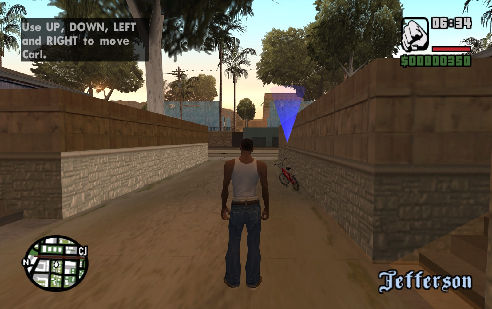

# Graphics options

Every graphics setting can be chosen in the launch window's **Graphics Options** (for every game) and changed in each
game's own **Display Setup**. The launcher's choices are given to the game each time it starts (as environment
variables, listed below); what is changed in the game lasts for that session.

## In each game

| Setting | GTA III | Vice City | San Andreas | How it works here |
|---|---|---|---|---|
| Screen resolution | Display Setup | Display Setup (start menu only, as released) | Advanced | Any size up to the display's Retina pixels, 32-bit or 16-bit; changing it in the game applies at once |
| Wide Screen | Display Setup | Display Setup | Advanced | Switches this port's widescreen (below) on and off |
| Anti-aliasing | — | — | Advanced | 2 or 4 samples (the game shows them as 1–3); GTA III and Vice City take the launcher's |
| Draw distance | Display Setup | Display Setup | Advanced | The game's own |
| Frame limiter | Display Setup | Display Setup | Advanced | On: the launcher's frame rate; off: as fast as the display shows |
| Trails | Display Setup | — | — | GTA III's motion blur, at any resolution |
| Brightness | Display Setup | Display Setup | Display Setup | The game's gamma ramp, applied as the picture is shown |
| Visual FX quality, MIP mapping | — | — | Advanced | The game's own |

## Widescreen

The games were made for 4:3. Their own widescreen settings crop the top and bottom of the 4:3 view; this port keeps
the 4:3 view's height and widens it with the screen instead (Hor+), as ThirteenAG's FusionFix does:

- the camera's view window is widened by the screen's shape over 4:3 for the camera that draws the whole screen
  (`CameraSize`), and the frustum's side planes with it (so nothing is culled at the edges);
- the aspect the aiming code uses is the screen's;
- the HUD is drawn in its 4:3 shape: each piece stays at the left edge, the right edge or the middle, according to
  where the game put it; lines of text keep together; what spans the whole screen (fades, the cinema bars) is left as
  it is. Menus and loading screens are shown 4:3 with black at the sides.

The launcher's **Widescreen** row picks the picture's shape: the display's own (a 16-inch MacBook Pro below its notch
is 2056×1290, about 16:10), a true 16:9 (thin bars above and below on a 16:10 display) or 4:3. **HUD** picks corners
or a centred 4:3 frame. Each game's own Wide Screen switch turns the wide view off (the original stretched 4:3) and on
again; the game's own crop is never used.

San Andreas listed only modes of five shapes (4:3, 5:4, 5:3, 16:10, 16:9) and fell back to 800×600 for anything else;
it now lists every mode.

## Resolution and colour depth

The games' Resolution lists hold the standard sizes up to the display's pixels, the display's own size in points and
pixels, and every shape of the display (full height and below the notch; its shape, 16:9, 16:10 and 4:3). The launcher
picks one: *Standard* is the display's height in points (macOS scales it up), *Retina* every pixel, *As Set in Game*
the game's saved choice.

**16-bit** modes ("x 16" in the lists, the launcher's *Colour: 16-Bit*) are drawn in 32 bits and shown as a 16-bit
screen of the time showed them: each colour to 5, 6 and 5 bits with a 4×4 ordered dither.

## Antialiasing

Multisampling: render targets and depth buffers are drawn with 2 or 4 samples (what the GPU offers) and resolved as
each pass that draws into them ends, so what the games read (their copies for post effects and trails, the present,
screenshots) is the smoothed picture. On Apple's GPUs the costly part of a Retina-sized multisampled pass is loading and
storing its samples (175 MB for a 4112×2658 4x picture), so the samples live only in the GPU's tile memory: each pass
resolves them as it ends, and a later pass starts by drawing the picture so far back into them (or by clearing, when
the game clears first). Draws that use no depth (the trails, the HUD) don't take the depth buffer into their pass, a
depth buffer no later pass reads isn't stored, and copies at the same size copy only their rectangle. The launcher's
default is 2x. San Andreas' own Anti-Aliasing setting works; GTA III and Vice City have none, so the launcher's applies
to them.

The fixed-function texture stages are drawn by shaders made for each combination of the stages' operations, arguments
and alpha test (Metal function constants), not by one shader that chooses them for every pixel: at Retina sizes that
choosing was most of the GPU's time.

What an M1 Pro holds at 4112×2658 with 4x antialiasing and PS2 lighting, capped at 120, driving:

| | GTA III | Vice City | San Andreas |
|---|---|---|---|
| Before | 60 | 60 (43 uncapped) | 60 |
| Now | 120 | 120 | 75 |

San Andreas' own game code takes about 13 ms a frame on this Mac (the same at any resolution or antialiasing), so it
runs at about 75; with *Frame Rate: 60* it holds 60 evenly.

## Frame rate

The games cap themselves at 30 fps (RsGlobal.maxFPS) while the frame limiter is on. *Frame Rate* sets the cap (60, the
display's rate, or 30 as released). The games' limiters measured each frame from the timer's update partway through
the last one, so every frame took the limit plus that part of the frame (San Andreas' 30 fps was 25, 60 was 43; with
VSync, GTA III and Vice City capped at 120 on a 120 Hz display rounded up to two refreshes, 60): each now waits for its
frame's due time by a steady clock. (The runtime this port shares with the author's other ports also held games at 60
until their work per frame left room for 120; the GTA games pace their play themselves, so it only holds their menus
and loading screens, which the games leave unlimited, at the same rate.) Above 30 fps, the parts of each game that count frames instead of time run at 30
fps's pace, as FusionFix's HighFPS does: millisecond timers carry their fractions (mission countdowns, script timers,
fades), things done every 16th or 32nd frame and the HUD's flashing count 30 fps frames, particles update 30 times a
second, and the radio station's name, the clouds' turn, the spin damping of cars and people and the objects mission
scripts rotate and slide (gates, lifts) go by the time step.

## PS2 lighting

*Lighting: PS2* (the default) brings back what the PC versions changed:

| | |
|---|---|
|  |  |
| PS2 | PC (as released) |

- **San Andreas' colour filter.** The PC draws the frame's copy over it twice with the time cycle's two colours, both
  added: the picture only ever gets brighter and washes out. The PS2 replaced the frame with it times twice the first
  colour, then added it times twice the second: the warm, contrasty Los Santos look.
- **San Andreas' radiosity**, the PS2's soft glow around bright areas: what is brighter than a limit, at a quarter
  size, blurred and added back over the frame after the colour filter (not under night or infrared vision). The PC
  game still has radiosity code, but it is off and its defaults only darken the picture, so the renderer draws it.
  `GTA_GLOW=<limit>,<strength>` (0–255, default 140,96) changes it.
- **Vice City's trails**, the PS2's motion blur in the time cycle's colour, which the PC release switches off.
- **Light clamping** on lit models (cars, people) in all three: the lights are summed and clamped before the
  material's colour multiplies them, so bright sunlight no longer washes them to white.

These follow aap's SkyGfx descriptions of the PS2's rendering; SkyGfx has no licence, so its formulas are reimplemented
and none of its code is used.

## Environment variables

What the launcher sets (useful when starting a game binary by hand):

| Variable | |
|---|---|
| `GTA_MODE=WxH` | the video mode to open in (empty: the game's saved one) |
| `GTA_MODES=WxH,...` | extra sizes for the games' Resolution lists |
| `GTA_DEPTH=32\|16` | the mode's colour depth |
| `GTA_MSAA=<samples>` | antialiasing (1 off) |
| `GTA_WIDESCREEN=1\|0`, `GTA_WIDE_HUD=anchor\|center` | widescreen and the HUD |
| `GTA_FPS=<n>` | the frame cap (0 uncapped); above 30 the high frame rate fixes |
| `GTA_LIGHTING=ps2\|pc` | PS2 lighting |
| `DS_DISPLAY=window\|fullscreen`, `DS_NOTCH=around\|below`, `DSR_VSYNC=1\|0` | the window |
